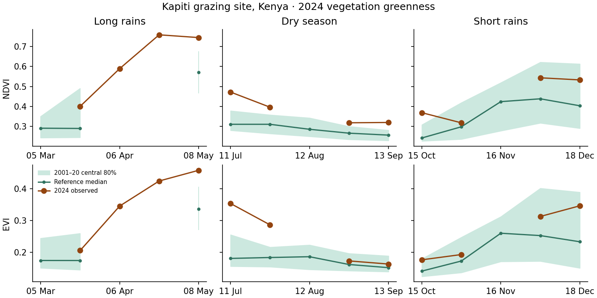

# Seasonal vegetation at Kapiti, Kenya

**Pilot finding.** In the 2.1 km square around the Kapiti rangeland flux site, both Terra MODIS vegetation indices increased during the short rains over 2001–2025. Dry-season slopes were smaller and their uncertainty intervals crossed zero. Cloud and pixel-quality screening particularly limited the long rains. This pilot supports reporting greenness against its usual seasonal pattern with an explicit coverage count. Neither pasture dry mass nor nutritional quality was measured here.

## Seasonal anomalies

The table reports index-unit differences against the 2001–2020 median for the same composite dates. A season needs at least three of five matched dates. Historical reference counts vary with cloud and other quality flags.

| Season | 2024 dates used | 2024 NDVI / EVI anomaly | 2025 dates used | 2025 NDVI / EVI anomaly |
| --- | ---: | ---: | ---: | ---: |
| Long rains | 2/5 | Insufficient coverage | 2/5 | Insufficient coverage |
| Dry season | 4/5 | +0.074 / +0.057 | 3/5 | +0.001 / −0.011 |
| Short rains | 4/5 | +0.116 / +0.048 | 2/5 | Insufficient coverage |



Dots show nominal composite start dates. A gap in the observed curve means fewer than 41 of 81 pixels passed screening. A gap in the reference means fewer than five historical observations for that date. Only five of 25 years supported a reportable long-rains anomaly, compared with 24 dry seasons and 17 short rains. In the reference period, the early- and late-April composite slots had four and three usable years respectively. A complete download alone cannot resolve these gaps.

## Trends

Slopes are index units per decade. Brackets give exploratory 95% intervals from a three-year block bootstrap. Each trend compares observations from the same seasonal slot across years and can use a partially observed season.

| Season | Usable composites / 125 | Years represented / 25 | NDVI slope [interval] | EVI slope [interval] |
| --- | ---: | ---: | --- | --- |
| Long rains | 50 | 22 | +0.023 [−0.048, +0.099] | +0.016 [−0.026, +0.055] |
| Dry season | 93 | 25 | +0.007 [−0.009, +0.025] | +0.007 [−0.002, +0.019] |
| Short rains | 72 | 24 | +0.053 [+0.012, +0.105] | +0.037 [+0.016, +0.072] |

Requiring all 81 pixels to pass kept 54 short-rains composites. The slopes were +0.032 NDVI [+0.007, +0.094] and +0.030 EVI [+0.015, +0.064] per decade. Omitting the first and last two years with the original screen gave +0.084 and +0.055 respectively. Direction persisted, magnitude varied. Long-rains trend coverage fell below the pilot threshold at both stricter spatial cutoffs. Both indices use the same satellite observations. The intervals do not account for sensor drift, changing vegetation composition or systematic clear-sky sampling. ILRI's field work at Kapiti also found a weak relationship between dry-season NDVI and fresh biomass. [ILRI Kapiti biomass study](https://www.ilri.org/knowledge/publications/uav-based-biomass-assessment-kenyas-drylands-insights-kapiti-research)

## Footprint, sampling and source checks

- The study used the published flux-site coordinates rounded to 1.614° S, 37.133° E. The native-grid square contains 9 × 9 equal-area MODIS pixels, each approximately 231.66 m wide, covering about 4.35 km². This is a sample of grazed savanna. It includes any trees or exposed soil in that square. Ranch boundaries, paddock occupancy and species-specific access were outside this measurement. [Kapiti site and rainfall seasons](https://doi.org/10.1029/2024JG008623)
- Sample five fixed 16-day Terra MOD13Q1 Collection 6.1 slots per season. Start days of year are 65–129, 193–257 and 289–353 respectively, spaced 16 days apart. These windows sample the core of the long rains, intervening dry season and short rains. Seasons are fixed across years. Start dates refer to composite periods and individual pixels may come from different dates within each period. [MOD13Q1 product](https://doi.org/10.5067/MODIS/MOD13Q1.061)
- The anonymous Planetary Computer route returned 366 unique Terra dates. Where the catalogue held two processings, the newest processing timestamp won. NASA ORNL provided the other nine dates. NASA CMR confirmed all nine processing identifiers at Collection 6.1. An overlap check on 8 May 2024 matched NDVI, EVI and QA at every pixel between providers. All 375 requested dates were present. [Planetary Computer collection](https://planetarycomputer.microsoft.com/api/stac/v1/collections/modis-13Q1-061) · [ORNL subset service](https://modis.ornl.gov/data/modis_webservice.html)
- Apply the scale factor 0.0001 to NDVI and EVI. Use the same mask for both indices, keeping raw values from −2000 through 10000, MODLAND QA 0, usefulness codes 0–2 and land pixels. Exclude high aerosol, adjacent or mixed clouds, possible snow and shadow. Take the spatial mean when at least 41 pixels pass. Repeat at 61 and 81 pixels. Across three seasons, 215 of 375 dates passed the first threshold.
- For each valid date, subtract its historical slot median (at least five valid reference years, excluding the target year). Report the median of those differences if at least three dates qualify. For trends, take the median of all within-slot pairwise slopes with actual year distances. Require at least ten distinct years overall and five years per slot. Resample contiguous three-year circular blocks of calendar years with replacement 1,000 times, carrying the five observations and their missingness together. These coverage cutoffs and block length are pilot choices.

## Can DMP be retrieved efficiently without GEE credentials?

The Copernicus Data Space Ecosystem (CDSE) offers direct, non-GEE access to the 300 m DMP v2 collection. On 12 November 2026 the public STAC endpoint returned DMP and quality-flag COG assets for all three March 2025 dekads, final revision RT6. The metadata response was 24,271 bytes and took 0.69 seconds on this run. The six full raster assets totalled 4.70 GB. A small spatial read would avoid transferring the global rasters. [Copernicus product and access](https://land.copernicus.eu/en/products/vegetation/dry-matter-productivity-v2-0-300m)

| Direct test | Result |
| --- | --- |
| HTTPS/OData node, 512-byte range per asset | HTTP 401 on all six requests |
| CDSE S3 object, same range | HTTP 403 on all six requests |
| Numerical DMP, QA and polygon throughput | Zero raster bytes obtained. Polygon throughput remains unmeasured. |

**Decision.** Use MODIS for the greenness pilot. Keep DMP optional in the design. The next DMP benchmark needs a CDSE-authorized read of both the raster and QA band or a verified public mirror of the same revision. Compare cold and cached polygon extraction, actual bytes and valid-pixel counts before selecting a package backend. The CDSE Statistical API also supports server-side aggregation with a registered client. [DMP layer specification](https://documentation.dataspace.copernicus.eu/APIs/SentinelHub/Data/clms/bio-geophysical-parameters/vegetation/dry-gross-dry-matter-productivity/dmp_global_300m_10daily_v2.html) · [CDSE Statistical API](https://documentation.dataspace.copernicus.eu/APIs/SentinelHub/Statistical.html)

## Reproduce

From the repository root, replay the checked-in [composite means, valid-pixel counts and granule provenance](composites.csv) with the toolkit Python dependencies. This writes annual anomalies, trends, sensitivity checks and the figure under the local validation directory.

```sh
python scripts/pilot_kapiti_forage.py --from-composites analysis/issues/issue_92_kapiti/composites.csv
```

To repeat the imagery extraction, install the optional rasterio dependency in the validation environment, then run the pilot with its default output directory. The first command fetches small raster windows and fills missing mirror dates. The second replays cached pixel data offline. The third repeats the anonymous DMP access test and records status, timing and sampled response sizes.

```sh
python scripts/pilot_kapiti_forage.py --workers 4
python scripts/pilot_kapiti_forage.py --offline
python scripts/probe_kapiti_dmp.py
```

This is an issue-specific research pilot. See [issue #92](https://github.com/CGIAR-Climate-Data-Hub/climate-toolkit/issues/92), the [dataset comparison](https://github.com/CGIAR-Climate-Data-Hub/climate-toolkit/pull/202) and the [current package architecture](../../package_architecture_summary.md).
