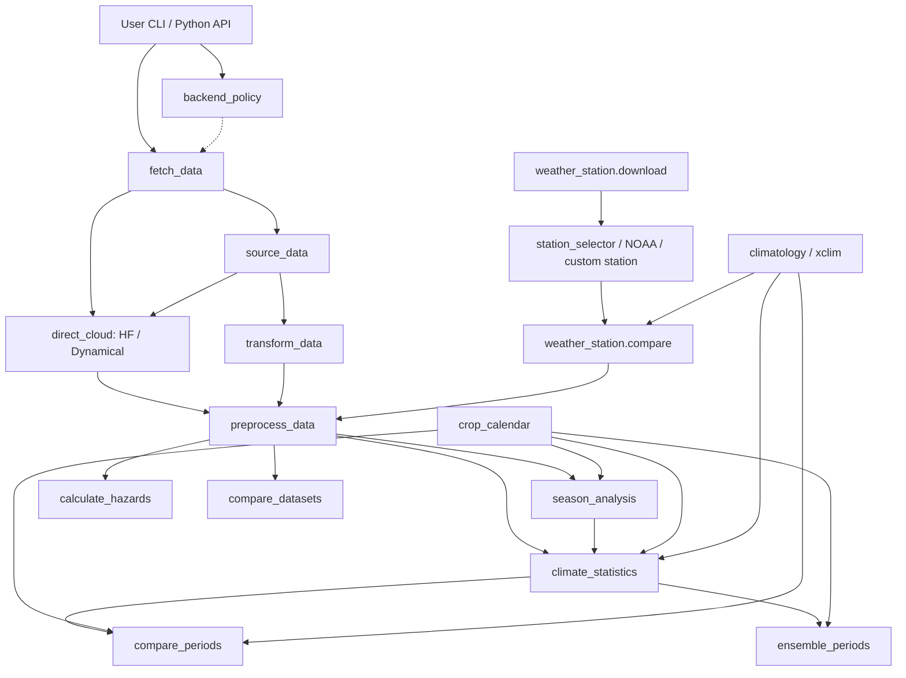

# Package Architecture Summary

Status: current working summary  
Updated: 2026-11-03

This file is intended to be current-state architecture reference for
developers, reviewers, and coding agents. It should describe actual runtime
behavior, not aspirational design.

## Purpose

`climate_toolkit` is modular Python package for:

- fetching and harmonizing climate data
- detecting seasons and summarizing climate conditions
- comparing historical periods and future NEX-GDDP periods
- calculating hazard indicators
- evaluating nearby weather-station data against gridded products

Package supports both:

- stable end-user CLI entry points
- stable top-level Python API names

## Stable public surface

Top-level stable Python API:

- `climate_toolkit.fetch_climate_data`
- `climate_toolkit.backend_policy` (task-local backend selection and GEE prohibition)
- `climate_toolkit.analyze_climate_statistics`
- `climate_toolkit.compare_climate_periods`
- `climate_toolkit.compare_climate_sources`
- `climate_toolkit.evaluate_hazards`
- `climate_toolkit.download_station_data`
- `climate_toolkit.compare_station_to_grids`
- `climate_toolkit.run_pipeline`

`run_pipeline` (`climate_toolkit/pipeline.py`) is the top-level orchestration
wrapper. It chains `fetch_climate_data` → `climatology.long_term_climatology`
(WMO 1991-2020 baseline) → `compare_climate_sources` (optional) →
`analyze_climate_statistics` → `evaluate_hazards` → `compare_climate_periods`
(optional), per site, with per-site status/error capture and a headline summary.
It composes the building blocks; it owns no analytics of its own. It accepts
`precip_source`/`temp_source` for a consistent pair and `backend`/`allow_gee`
controls for the whole run. Paired/auto initial fetches reuse the season workflow's
source resolution; exact sources use the public fetch API. Climatology reuses
that same season ingestion path for paired/auto sources. Worker and explicit
project controls are forwarded to supported stages.

A returned `{"error": ...}` fails the current pipeline stage just like an
exception. Failed stages are not listed as completed. Date-only requests derive
years for seasonal statistics; those statistics cover calendar years, while the
initial daily fetch and hazard request retain the supplied dates. A bad site is
isolated from the rest unless `raise_on_error=True`.

With `output_dir`, the pipeline writes `summary.csv`, run `metadata.json` and
`<index>_<safe-site-name>/` directories containing daily CSV/metadata, JSON stage
reports and `status.json`. Source-comparison CSVs use a per-site child directory.
Reusing an output directory removes old pipeline report files for stages that
produced no current result. Duplicate site names remain separate by index.

Stable CLI entry points from `pyproject.toml`:

- `climate-toolkit <command>` (unified dispatcher; supports `--backend` and `--no-gee`)

- `climate-toolkit-fetch`
- `climate-toolkit-seasons`
- `climate-toolkit-seasons-ensemble`
- `climate-toolkit-stats`
- `climate-toolkit-stats-ensemble`
- `climate-toolkit-periods`
- `climate-toolkit-periods-ensemble`
- `climate-toolkit-hazards`
- `climate-toolkit-hazards-ensemble`
- `climate-toolkit-weather-station-download`
- `climate-toolkit-weather-station-compare`
- `climate-toolkit-compare-datasets`
- `climate-toolkit-climatology`

Internal modules below these surfaces are importable but not stable contract.

## Layer model

### 1. User entry layer

Human-facing entry points:

- top-level package exports in `climate_toolkit/__init__.py`
- CLI modules with `main()` functions
- optional source-tree FastAPI service in `apis/`, installed with the `api`
  extra and run as `uvicorn apis.main:app`; it delegates to package workflows
  and is not included in the installed `climate_toolkit*` distribution

This layer should remain thin. It should parse args, call library functions,
print/save output, and avoid owning core science logic.

### 2. Workflow orchestration layer

Main orchestration modules:

- `fetch_data/fetch_data.py`
- `season_analysis/seasons.py`
- `climate_statistics/statistics.py`
- `compare_periods/periods.py`
- `compare_periods/ensemble_periods.py`
- `calculate_hazards/hazards.py`
- `weather_station/download.py`
- `weather_station/compare.py`

These modules coordinate:

- source selection
- fetch windows
- cache usage
- seasonal or period reductions
- reporting and persistence

### 3. Data-source and transform layer

Fetch pipeline roots:

- `fetch_data/source_data/`
- `fetch_data/transform_data/`
- `fetch_data/preprocess_data/`

Key responsibilities:

- raw source access
- variable-name harmonization
- unit conversion
- stage transitions: raw -> transformed -> preprocessed

Important shared helpers:

- `fetch_data/backend_policy.py`: task-local policy, GEE guards, process-worker propagation and provenance sidecars
- `fetch_data/direct_cloud.py`: anonymous CHIRPS/CHIRTS providers, grid/coverage checks, QC and revision-aware caches
- `fetch_data/gee_xee_batch.py`
- `fetch_data/nex_gddp_batch.py`
- `fetch_data/multi_site.py`
- `fetch_data/cache_inventory.py`
- `fetch_data/runtime_notes.py`

### 4. Shared analytical building blocks

- `season_analysis/season_identity.py`
- `crop_calendar/ggcmi.py`
- `crop_calendar/registry.py`
- `climatology/spei.py`
- `climatology/xclim_reference.py`
- `weather_station/overrides.py`

These modules support multiple higher-level workflows.

`visualization/` supplies shared matplotlib styles, variable labels, text helpers,
timeline helpers and figure IO. ERA example plots consume it; it does not own
source routing or scientific reductions and adds no stable top-level export.

### 5. Resource and packaged-data layer

Static packaged resources:

- GGCMI crop calendar parquet/json under `climate_toolkit/data/ggcmi_phase3/`
- variable dictionaries / YAML config files
- hazard parameter JSON

Resource loading should remain package-safe and install-safe.

## Core workflow graph

## Actual package coupling

### `fetch_data`

`fetch_data` is central shared ingestion path.

It handles:

- source dispatch
- single-site and multi-site fetch
- stage selection
- cache-directory routing
- Earth Engine/Xee batch routing for many historical sources
- NEX-GDDP-specific routing
- direct cloud single/multi-site routing before GEE batch dispatch
- exact coverage and QC requirements for direct products

This module is foundation layer for most package.

### `season_analysis`

`season_analysis.seasons` owns:

- ET0 derivation
- water-balance prep used by season logic
- auto onset/cessation detection
- fixed-season parsing
- year-level season outputs

Other modules reuse this logic rather than duplicating season detection.

### `climate_statistics`

`climate_statistics.statistics` builds on fetched climate data plus season
detection. It produces:

- raw climate summaries
- overall statistics
- season statistics
- LTM summaries
- optional SPEI blocks
- season detection review status

This module is main reducer used by `compare_periods`.

### `compare_periods`

Two main modes:

- historical or paired focal-vs-baseline comparison in `periods.py`
- NEX-GDDP baseline-LTM vs future-LTM ensemble comparison in
  `ensemble_periods.py`

This layer depends heavily on output shape from `climate_statistics`.

### `calculate_hazards`

Hazard calculations consume analysis-ready daily climate series, crop
parameters, and soil/water-balance assumptions.

Current implementation includes NDWS/WRSI-related work and hazard thresholds,
with ongoing alignment to Atlas / xclim follow-up tracked in issue docs.

### `weather_station`

Weather-station support is parallel track, not replacement for gridded path.

It provides:

- station discovery / selection
- GHCN-Daily and GSOD access
- custom station ingestion
- candidate-review outputs including map/html/json/csv
- station-vs-grid comparison against toolkit climate sources

Weather-station outputs can also override historical variables in some climate
analysis workflows.

## Data-source architecture reality

Important practical split:

- local-open sources
- Earth-Engine-authenticated sources
- fragile / optional sources

Current reality documented in more detail here:

- `analysis/source_access_matrix.md`

Actual routing and source policy:

- `chirps_v3_daily_rnl`: complete compatible direct cache first, then Dynamical
  final/RNL, Hugging Face final/RNL, then permitted GEE. `chirps` still aliases
  `chirps_v2`. Preliminary/SAT and v2 are never mirror fallbacks.
- `chirts_era5`: Hugging Face CHIRTS-ERA5 Tmax/Tmin, currently the only integrated
  provider. Actual time coordinates determine coverage; no clipping to a stale
  documented end date. This is a distinct scientific product.
- `chirts`: deprecated CHIRTS-daily compatibility adapter (1983–2016). Explicit
  requests retain their meaning; automatic historical fallback uses CHIRTS-ERA5.
- Normal historical `auto` first pairs CHIRPS v3 with `agera_5`, which currently
  means **ERA5-Land**, not the separate AgERA5 product. It retains ERA5-Land/ERA5
  alternatives before its final CHIRPS v3 + CHIRTS-ERA5 fallback.
- With GEE prohibited, historical `auto` selects CHIRPS v3 + CHIRTS-ERA5 directly.
  This pair supplies rainfall and Tmax/Tmin only. Humidity/wind/radiation-dependent
  calculations retain their input requirements.
- Other historical gridded products and `nex_gddp` retain GEE/Xee routes.
  NASA POWER and station products have direct HTTP paths; TAMSAT remains optional.

ERA5-Land direct access is shelved because CDS requires credentials; it is not
runtime routing. The
[issue 180 memo](issues/issue_180_era5_land_access.md) records CDS authentication
failures, candidate coverage and the required daily aggregation contract.
`scripts/probe_era5_land_access.py` checks metadata access only and registers no
source/backend. Public descriptions use ERA5-Land; the legacy `agera_5` key remains.

`backend_policy` owns selection controls, independent of scientific source
selection. `fetch_climate_data(..., backend=..., allow_gee=...)` can override the
context; higher-level workflows use the context or environment settings. Unified
CLI commands expose policy flags; standalone fetch also exposes them. Library
model-worker submissions explicitly propagate policy into spawned processes.
Low-level GEE initialization guards enforce prohibition even on legacy routes.
Explicit backend selection never silently changes a cloud-enabled provider.

Direct adapters require Python 3.12+ and the optional `cloud` extra; base package
support remains Python 3.10+. Providers decode units once and subset before load.
Direct preprocessing skips legacy filling/heuristic conversions. Scientific QC
failures abort analysis; transport, schema and incomplete-coverage failures may
try another eligible mirror. All returned years use one provider revision.

## Cache and persistence model

Main cache root:

- `outputs/cache/...`

Cache design now matters architecturally because many workflows expect warm
cache reuse across runs, not session-only transient data.

Major cache families:

- historical GEE/Xee chunk caches
- NEX-GDDP caches
- weather-station source caches
- direct cloud annual request caches: `direct_cloud/v2/<source>/<backend>/<request-hash>.json`
- inventory/manifest views for audit (including `direct_cloud`)

Direct cache envelopes contain checksummed JSON data, dtypes/column order,
request identity and provider provenance. Writes are atomic. Cache keys include
source, provider, variables, exact requested coordinates and annual date window.
Immutable upstream revision lives in the envelope: a fully cached request works
offline; incomplete requests reuse chunks only when revision matches current
provider metadata. Refresh replaces records explicitly. Old GEE caches remain
separate. No provider/day stitching or implicit revision mixing is allowed.
Missing consecutive years are extracted together in batches of at most five years
to share source chunks across year boundaries. Each completed batch persists
separate annual records; later failures retain that progress. Cached intervening
years are not reread, and upstream revision changes still invalidate reuse.

Direct frames carry `data_provenance`, `backend_attempts` and `quality_control`
attrs. Provenance records revision, retrieval time, actual coverage, selected grid
cells and conversion; estimates of decoded source-chunk work are not network bytes.
Fetch and dataset-comparison exports preserve attrs in `.metadata.json` sidecars.
Reopening an exported CSV through dataset comparison restores supported provenance
fields. Overwriting a file with unattributed data removes its stale sidecar.
A default 4 GiB estimated chunk-work budget bounds amplification; transport timeouts
are per request, not a whole-workflow deadline.

When changing cache layout, update this file and user docs.

## Current design constraints

### Historical vs projection split

Package now effectively has two large execution families:

- historical / recent climate workflows
- future projection / NEX-GDDP workflows

They should stay harmonized where possible, but do not need identical backends.

### Comparison modules depend on payload shape

`compare_periods` and `ensemble_periods` assume fairly specific output schema
from `climate_statistics`. Any schema change here is architectural and should
be documented.

Additive provenance contracts: climate-statistics results expose a top-level
`data_provenance` list; period comparisons expose baseline/focal provenance;
climatology top-level and annual results, hazard assessment entries and station fetch diagnostics
also carry provenance. Paired source merges preserve both product histories.
Human-heat source metadata is reconciled against fetched columns/provenance: missing
humidity, dewpoint, wind or radiation sources are null, including CHIRTS-ERA5 auto
pairs. Existing scientific metric fields are unchanged. Direct-source climatology requires
every requested year; it cannot apply the legacy 80% year-availability tolerance.
Scientific QC errors propagate instead of silently dropping a year or a compared
source. Climatology CLI accepts paired source flags and returns nonzero on an
error payload. Existing non-direct climatology completeness policy is retained.

### Reporting still mixed with library logic in some modules

Refactor work improved package shape, but some large modules still mix:

- orchestration
- reduction logic
- report rendering
- CLI save behavior

This remains known technical-debt area.

## Where to read next

Use these docs together with this summary:

- direct provider usage and limitations:
  - `docs/direct_cloud_access.md`
  - `analysis/issues/issue_176_178_direct_cloud_access.md`
- source/backend reality:
  - `analysis/source_access_matrix.md`
- package-shape / import-contract history:
  - `analysis/issues/package_refactor_investigation.md`
- weather-station design:
  - `analysis/weather_station_module_design_2026-06-15.md`
- NEX runtime / access notes:
  - `analysis/nex_gddp_access_rnd.md`
- regional fast-pool decision memos:
  - `analysis/nex_regional_fast_pool_eaf.md`
  - `analysis/nex_regional_fast_pool_waf.md`
  - `analysis/nex_regional_fast_pool_andes.md`

## Maintenance rule

Update this file whenever any of these change:

- stable top-level Python API names
- CLI entry points
- module ownership boundaries
- major inter-module dependencies
- source routing model
- cache layout / persistence rules
- weather-station integration path
- compare-periods payload contracts

If change is local bugfix only, no update needed.

